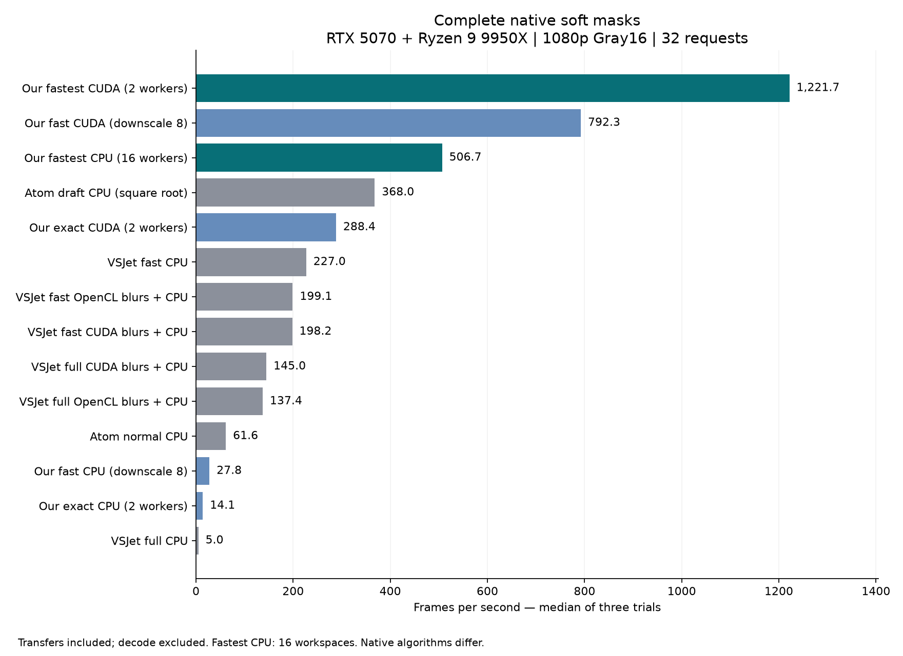
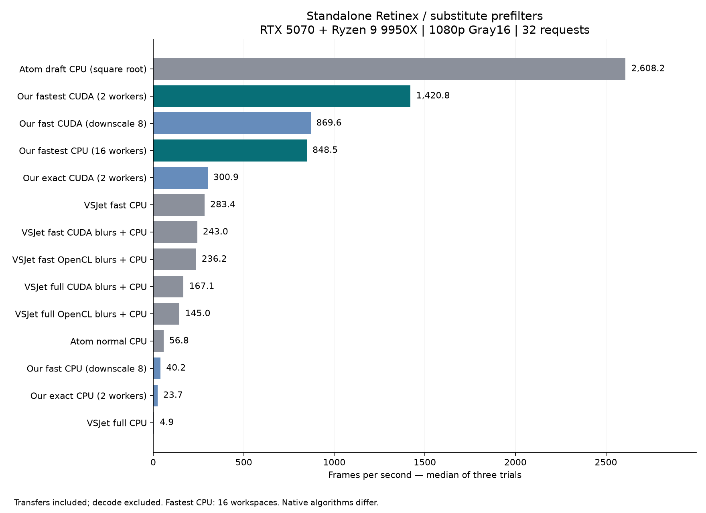

# Benchmark results

Current 2.1 DLLs, VSJet **3.0.0**, official vszip **24.0.0**, vszipcu/vszipcl
**1.2.0**. RTX 5070 and Ryzen 9 9950X, Windows x64, VapourSynth R81,
Python 3.14.10, BestSource 23. This is one 1920×1080 episode on one system.

| Native implementation | Retinex FPS | Mask FPS |
|---|---:|---:|
| Our fastest CUDA (2 workers) | 1420.8 | 1221.7 |
| Our fastest CPU (16 workers) | 848.5 | 506.7 |
| Our exact CUDA (2 workers) | 300.9 | 288.4 |
| Our fast CUDA (downscale 8) | 869.6 | 792.3 |
| Our exact CPU (2 workers) | 23.7 | 14.1 |
| Our fast CPU (downscale 8) | 40.2 | 27.8 |
| Atom normal CPU | 56.8 | 61.6 |
| Atom draft CPU (square root) | 2608.2 | 368.0 |
| VSJet fast CPU | 283.4 | 227.0 |
| VSJet full CPU | 4.9 | 5.0 |
| VSJet fast CUDA blurs + CPU | 243.0 | 198.2 |
| VSJet full CUDA blurs + CPU | 167.1 | 145.0 |
| VSJet fast OpenCL blurs + CPU | 236.2 | 199.1 |
| VSJet full OpenCL blurs + CPU | 145.0 | 137.4 |

Fastest CPU masks reached **2.23× VSJet fast CPU**, while fastest CUDA
was the fastest tested complete mask. The CPU result uses 16 frame workspaces
and many concurrent requests. It does not establish the same advantage on a
smaller CPU or during sequential frame requests. CPU-only output agrees with
the CPU engine in the all-in-one build in regression tests; this throughput
table times the all-in-one CPU engine.

Standalone Retinex and complete masks are separate workloads. Atom draft's
square-root prefilter is faster than our fastest standalone Retinex, while its
complete mask is slower here. Native masks have different edge pipelines.
Similarity to exact does not establish a perceptual-quality winner.

## Timing method

Each trial receives the same **60 unique predecoded frames**: 20 from each
sequence starting at 1440, 10080 and 30240. Eight separate warmup frames repeat
for at least 0.5 seconds. An entire timed batch repeats until at least one second
has elapsed; slow paths may complete just one batch. Actual frames, cycles,
duration, process CPU use and project worker counts are recorded per trial.
The table is the median of three trials, with 32 requests and 32 VapourSynth
core threads: 84 trials covering 28 candidate/stage combinations.

Fresh graphs and all native intermediate caches are disabled. Trial order rotates.
Input/output transfers and allocation are included. Decoding, luma/depth conversion,
graph construction and warmup are excluded. This measures warmed filter throughput
on repeated fixed input, not whole-episode decoding/encoding speed. Unrelated
system activity was not controlled by the harness.

Our exact uses two workspaces; fast uses one with downscale 8. Fastest uses 16
CPU workspaces or two CUDA workspaces. GPU fallback is disabled for all project
CUDA paths. Options: sigma 50/200/350, percentile tails .001/.005, blur sigma 1,
Prewitt op 1. VSJet DRE uses `brz=0` to compare soft masks rather than its
default thresholded mask. Memory limits apply per fastest workspace.

## Native backend verification

VSJet CUDA and OpenCL Retinex combine full-resolution native Gaussian filters
with CPU expressions/statistics and other CPU stages. Fast has two Gaussian
nodes, full has three; masks add a sigma-1 blur. CPU fast also downsamples its
remaining Gaussian work; GPU fast does not. Our CUDA intermediates remain on
device between upload and download. Native GPU Gaussian uses finite float FIR
taps, while our illumination uses recursive Gaussian. These are different
native implementations, not equal-work microbenchmarks.

All 28 candidate/stage graphs were executed. Installed
VSJet Python files match pinned 3.0.0 source, and native comparison DLLs match
official wheels. See [raw comparison](../results/comparison.json),
[backend audit](../results/backend-audit.json),
[image differences](Image-comparisons.md) and [reproduction](Reproduce-the-tests.md).
